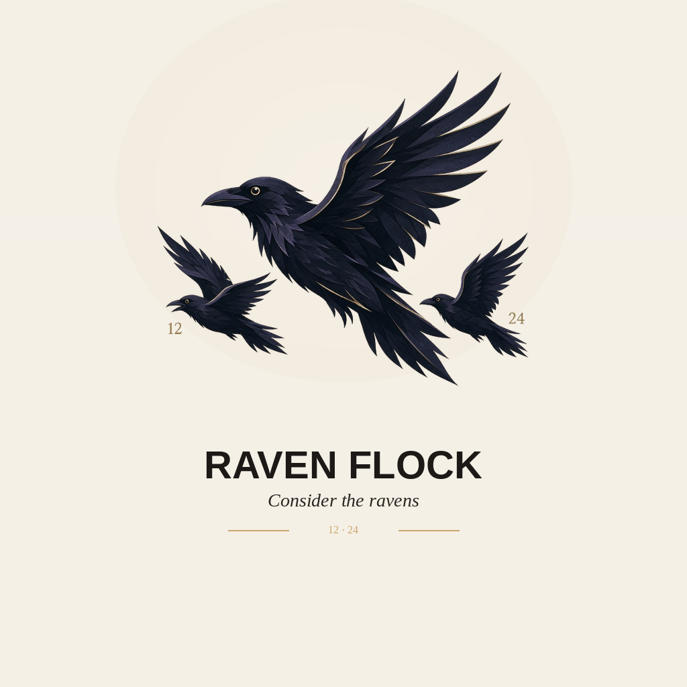

  

<h1 align="center">Raven Flock</h1>

<em>Quiet tools. Consider the ravens. A reminder you are not forgotten.</em>

---

### Luke 12:24

> Consider the ravens: they neither sow nor reap, they have neither storehouse nor barn, and yet God feeds them. Of how much more value are you than the birds!

The name is from that verse. Ravens do not farm or stockpile, and they are still fed. The point is not birds. The point is you. A loving God already cares for you — more than the flock He keeps in the air.

### Mission

Raven Flock exists to help people *know* they are cared for by a loving God — not as a slogan, as a lived reminder.

We build small, honest things:

- tools that lower noise instead of adding it
- work a neighbor can actually use
- no account walls when a quiet gift will do

If a sit, a game, or a local-business fix gives someone one less thing to carry, that is the work.

### In the shop

- **[Studio site](https://raven-flock.github.io/raven-flock/)** — Raven Flock home
- **[Stillpoint](https://raven-flock.github.io/Meditation-App/)** ([itch.io](https://dust2ash7.itch.io/stillpoint)) — timed sits, box breathing, wind-down
- **[Labor Pulse](https://raven-flock.github.io/raven-flock/#labor-pulse)** ([GitHub](https://github.com/Raven-Flock/Labor-Pulse)) — quiet labor companion (not a medical device)
- **Life Formed** — coming soon · Soft Mastery · [Play teaser](https://dune-palm-fire-heart.grok.me) · *Tend the Garden. Bring order to the chaos.*
- **[Aerie](https://raven-flock.github.io/Aerie/)** — a quiet room to make a song
- **[Meridian Atlas](https://raven-flock.github.io/meridian-atlas/)** ([GitHub](https://github.com/Raven-Flock/meridian-atlas)) — calm field guide to points, channels, and Chinese herbs (educational only, not medical advice)
- **[Microbiome Kitchen](https://raven-flock.github.io/Microbiome-Kitchen/)** ([GitHub](https://github.com/Raven-Flock/Microbiome-Kitchen)) — beginner whole-food meals for gut and brain
- **[Sentinel Strength](https://raven-flock.github.io/Sentinel-Strength/)** ([GitHub](https://github.com/Raven-Flock/Sentinel-Strength)) — bodyweight training for physical jobs
- [Buy me a coffee](https://www.buymeacoffee.com/nrsteward) — optional. Tips keep the flock building.

### Also playable

- [2048](https://raven-flock.github.io/2048-puzzle/)
- [Space Fish](https://raven-flock.github.io/space-fish/)
- [Mochi Drop](https://raven-flock.github.io/mochi-drop/)

---

  
   
  Raven Flock — quiet tools. 
  <em>Consider the ravens.</em> · A reminder you are not forgotten. 
  Vista / San Diego County

